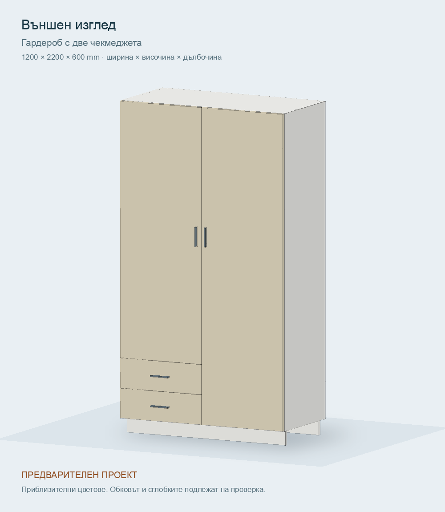
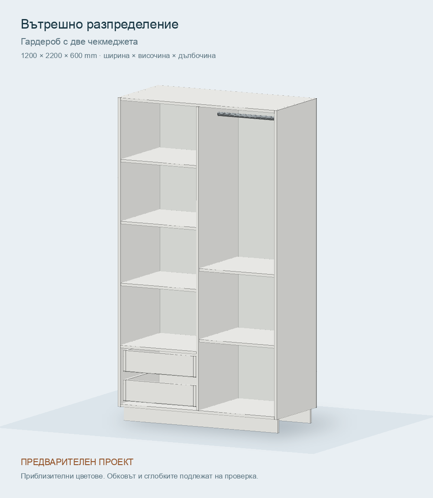
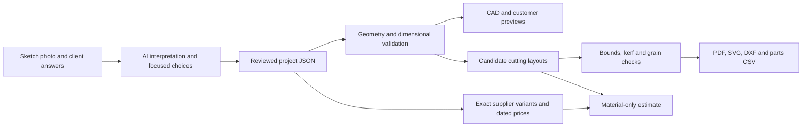

# Sketch to Furniture

**A furniture design workflow built around the way a cabinetmaker already works: a pencil, a sheet of paper, and a conversation with the customer.**

An AI assistant interprets a photographed sketch and asks focused questions. A Python engine turns the reviewed specification into editable CAD, geometry-based material previews, cutting plans, and a dated material estimate. The same panel data drives the model and the cut list.

**[Open the project gallery](https://plamen911.github.io/sketch-to-furniture/)** · [Start in ChatGPT](START_HERE.md)

Built by [Plamen Markov](https://plamen.lynxlake.org/). **Status: working prototype, evaluated on one real wardrobe design.** Broader sketch recognition, phone delivery, and Free-plan execution still need field testing.

<p>
  
  
</p>

*Generated from the same geometry as the CAD exports. Colors are approximate; these are not manufacturer-certified finish samples or photorealistic renders.*

## The problem

A cabinetmaker often develops a design on site, drawing in front of the customer. Recreating that sketch later in CAD delays visual approval and separates the sales conversation from workshop preparation. Missing dimensions, nominal module sizes, edge-band thickness and hardware assumptions can also turn a convincing picture into an incorrect cut list.

Sketch to Furniture preserves that on-site workflow. It helps the maker reach a reviewable design early, while keeping the unresolved manufacturing decisions explicit.

## Meeting preparation — 24 November 2026

A [provisional workshop profile](references/stoyan-profile.md) allows preliminary work before Stoyan confirms his construction conventions. Defaults remain assumptions and never override explicit project decisions. The public gallery gives each selected, sanitized design a stable phone-friendly URL. Add projects through [the explicit publication registry](references/public-gallery.md); a ChatGPT upload does not automatically publish to GitHub.

The meeting will validate construction, edge banding, hardware, cutting settings and the actual Free-account workflow. One reviewed wardrobe is evidence of a working prototype, not arbitrary-sketch manufacturing accuracy.

## What works today

- **Reviewed sketch interpretation:** reusable instructions for reading dimensions, consulting existing answers, and asking 1–3 short questions with limited choices. Image interpretation is performed by the assistant; the Python engine is not an OCR system.
- **Consistent panel geometry:** finished dimensions, raw cutting dimensions and per-edge band thickness are kept separate. Validation rejects invalid thicknesses, solid-panel collisions, duplicate IDs and panels outside declared bounds.
- **Editable exports:** named components and materials in COLLADA DAE and OBJ/MTL; orthographic front/side/top drawings in DXF/SVG. Native SKP is not generated, and a real SketchUp import remains to be verified.
- **Cutting plans:** four deterministic guillotine-strip candidates, stock trimming, kerf clearance, grain/rotation constraints, material grouping, SVG/DXF and one landscape A4 PDF page per board. Lower bounds identify cases where minimum board count can actually be proven.
- **Customer previews:** exterior/interior PNGs and a self-contained interactive browser viewer with orbit, zoom, part highlighting and color trials. A depth buffer prevents hidden shelves appearing through closed doors.
- **Material estimates:** whole-sheet purchasing, exact supplier variants, VAT-inclusive observed prices, unit/pack checks, dated source links, and explicit unpriced or provisional lines. Labor, profit and final customer price stay unfilled.

## Why this is an AI engineering project

The model handles ambiguous visual input and conversation. Deterministic code owns the dimensions, edge deductions, geometry validation, nesting and arithmetic. Earlier assistant assumptions are not promoted to client-confirmed facts. A plausible image is not treated as proof of manufacturing accuracy.

The reference case exposed concrete failure modes: confusing a 600 mm nominal bay with clear width; treating a 1100 mm hanging space as a rail-axis dimension; carrying an incorrect material code forward; using a cached price instead of a live promotion; and drawing internal components over closed fronts. The workflow, validation and renderer address these separately.



## Run the reference example

Python **3.10+** is sufficient for CAD, cutting plans and the HTML viewer. PNG rendering additionally uses Pillow. There is no OpenAI API key, paid rendering API, backend service or network call in the generator.

```bash
# Optional, for exterior.png and interior.png
python3 -m pip install -r requirements-render.txt

# Choose a fresh output directory; existing results are never overwritten.
python3 scripts/furniture.py examples/wardrobe/project.json --out projects/wardrobe/preview

python3 scripts/test_furniture.py
python3 scripts/test_costing.py
python3 scripts/package_skill.py
```

Open the generated `index.html` in a browser. The output directory includes CAD, drawings, cutting plans, part data, material-cost CSV/JSON, validation results, checksums and a ZIP package. If Pillow is unavailable, the report says so and the browser viewer can export a PNG.

The public example is a sanitized reconstruction. Original photos, customer conversations and live working projects are kept out of Git under `projects/`.

Preferred Bulgarian research sources are [Kedar](https://www.kedar-ood.com/) and [ROSI](https://rosi.bg/bg). Prices and textures must match the exact product variant; an unavailable public price remains unquoted.

## Using it in ChatGPT

The intended interaction is a photo and a conversation, including from a phone. See the [Bulgarian user guide](docs/user-guide-bg.md).

The package builder creates a skills-only plugin under `dist/plugin/` and a versioned ZIP. [OpenAI distinguishes standalone skills from plugin-bundled skills](https://learn.chatgpt.com/docs/build-skills); the latter are the distribution route across ChatGPT web, desktop and mobile. A compatible host still needs actual file/code execution tools.

| Target | Status |
| --- | --- |
| Local Python engine | Implemented and tested |
| Browser viewer | Tested in desktop Chrome; phone browsers pending |
| ChatGPT Desktop local execution | Used during development; fresh plugin install pending |
| ChatGPT web and mobile | Portable package prepared; account-level end-to-end test pending |
| ChatGPT Free | Design target; no paid API required by the code, but account tools and limits must be tested |
| Installed plugin GitHub auto-sync | Not established for personal Free accounts |

A package cannot grant tools, remove usage limits or enable a paid capability. [Official plan documentation](https://learn.chatgpt.com/docs/pricing) is separate from this project's execution requirements. The fallback when code execution is unavailable is a reviewed structured specification, not invented output files.

## GitHub updates and distribution

The source of truth is this repository. The same successful main-branch build publishes a sanitized, read-only example viewer to GitHub Pages; it does not process new uploaded photos or run a hidden paid model. The workflow tests changes and rebuilds the portable package. On a successful push to `main`, it also updates the generated `distribution` branch without force-pushing. The branch contains the plugin and its marketplace manifest and can be used by a compatible GitHub-backed distribution path.

**This is repository-to-package automation, not a claim that uploaded files or every installed ChatGPT plugin update themselves.** [Workspace-managed GitHub import/sync](https://learn.chatgpt.com/docs/enterprise/plugin-management) requires administration. A personal Free account's installation/update path still needs verification. Local source checkouts can use `python3 scripts/sync_repo.py`, which refuses dirty worktrees and accepts only fast-forward updates.

See [platform and synchronization details](references/platforms-and-sync.md).

## Evidence and next evaluation

The reviewed reference is a 1200 × 2200 × 600 mm wardrobe with two left drawers, three left shelves, two right lower shelves and a 1100 mm clear hanging zone. Its materials include 18 mm white particleboard, AGT 730A cream matte MDF and a 3 mm HDF back. Hardware, joinery and some banding choices remain provisional.

Tests cover dimension chains, raw-size deductions, collision and invalid-input rejection, kerf/stock/grain constraints, CAD units and indices, file integrity, no-overwrite behavior, material units, VAT handling, purchase increments and stale prices. These tests do **not** establish recognition accuracy on arbitrary sketches.

The next field tests will use different, more complex designs. Each demonstrated failure should produce a reviewed correction and a regression case. This is iteration on the skill, tooling and evaluation corpus; it is **not model fine-tuning**. No cross-project accuracy or time-saving metric has been measured yet. See the [evaluation protocol](evals/README.md).

## Project structure

```text
SKILL.md                    Reusable assistant workflow
scripts/                    Geometry, nesting, exports, pricing and packaging
assets/viewer.html          Standalone interactive viewer
references/                 Input schema, drawing conventions and platform rules
pricing/                    Dated supplier observations, not a live price feed
examples/wardrobe/           Sanitized reproducible project
projects/                   Private working inputs and results (ignored)
evals/                      Reviewed cases and improvement protocol
docs/                       User guide, previews and portfolio copy
.github/workflows/          Tests and generated distribution updates
```

## Limits and roadmap

Current geometry is axis-aligned rectangular panels plus schematic fittings. There are no CNC toolpaths, drilling plans, hinge-motion simulation, structural calculations or manufacturer texture ingestion. Nesting does not claim globally shortest cut time. Unspecified HDF stock or hardware keeps both the cutting scope and material estimate incomplete.

Next priorities are real phone/Free-account acceptance tests, more sketch types, confirmed workshop defaults and hardware rules, reusable offcut inventory, and more complete material pricing. Labor and selling-price policies can follow when the maker supplies them.

## License and author

MIT; see [LICENSE](LICENSE). Supplier prices and product references are attributed observations, not endorsements or a guarantee of availability. Original customer drawings are not included in the public package.

[Plamen Markov — portfolio](https://plamen.lynxlake.org/) · [GitHub](https://github.com/plamen911)
